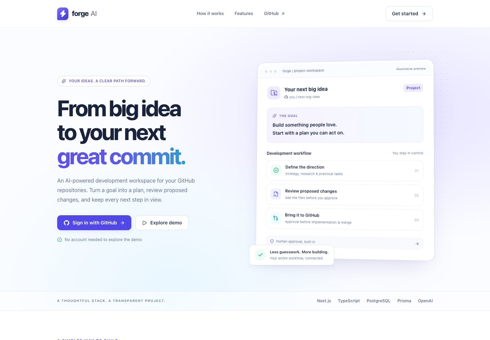
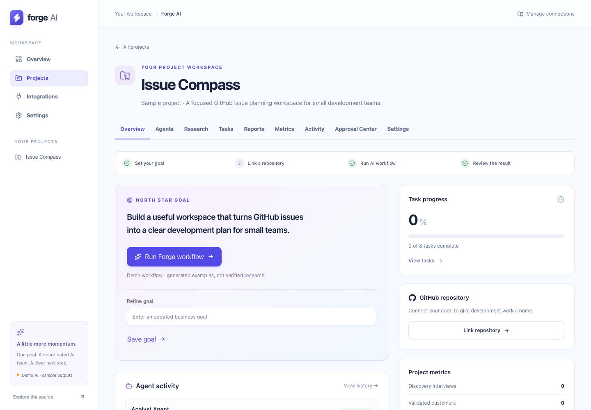
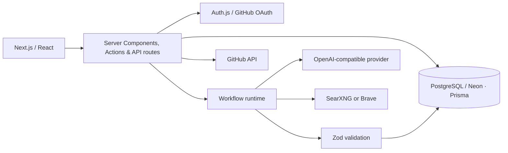

# Forge AI

**AI-powered development workspace connected to your GitHub repositories.**

Forge AI brings project goals, GitHub repositories, and AI-assisted planning into one workspace. Create a project, run a validated workflow, and turn its results into tasks and reports. Repository changes stay behind explicit human approvals.

[Explore the code](https://github.com/zekeriyedemir/forge-ai) · [Deployment guide](docs/deployment.md) · [Architecture](docs/architecture.md)

## Live demo

Not deployed yet. Run locally using the steps below, or deploy to Vercel with Neon using the [release guide](docs/deployment.md).

The public **`/demo`** page is a read-only, interactive sample: no account, database, API credits, or repository access required. The real workspace uses GitHub sign-in.

## Screenshots




Screenshots show the application running locally with clearly labeled sample data.

## What Forge AI does

1. **Connect GitHub** and browse the repositories your account can access.
2. **Create a project** with a clear goal, then link its repository in Integrations.
3. **Run a workflow:** strategy → research → refined strategy → development plan → progress review.
4. **Review the output:** persisted tasks, reports, metrics, research evidence, and activity.
5. **Optionally propose a code change.** Inspect the proposed files, approve a branch and pull request, review CI, and approve a merge separately.

## Key features

- GitHub OAuth, database-backed sessions, private workspaces, and owner-only project mutations.
- Searchable repository selection and server-side GitHub API integration.
- Five-step workflows with bounded AI calls, Zod-validated results, safe failures, and transactional persistence.
- Live research through SearXNG or Brave, with bounded public-page retrieval and exact-quote validation.
- Human-approved repository changes, CI checks, correction proposals, and stale-head protection.
- Responsive interface with pending, empty, error, and success states; typed-name project deletion.
- Credential-free sample experience and deterministic local development mode.

## Architecture



One Next.js application handles the frontend and backend. The browser advances one persisted workflow step per request; this is not a background job service. Database claims prevent duplicate execution, and generated content commits atomically with run completion. See [architecture](docs/architecture.md) and [developer execution](docs/agents.md#developer-repository-execution) for limits and recovery behavior.

## Tech stack

Next.js 16 · React 19 · TypeScript · Tailwind CSS 4 · PostgreSQL / Neon · Prisma 6 · Auth.js · GitHub REST API · OpenAI-compatible Chat Completions · Zod · Vitest · Playwright · Docker · GitHub Actions · Vercel

## Engineering highlights

Authorization is enforced on the server and repeated inside critical database mutations. A failed structured response cannot leave partially saved tasks or reports. Workflow start uses serializable transactions, execution uses database claims, and provider responses have time and size limits. Integration tests exercise real PostgreSQL persistence and cascading deletion; browser tests cover project creation, workflow results, ownership boundaries, and deletion.

## Running locally

Use **Node.js 22+** and PostgreSQL 16. Docker is optional for the application, but provides a convenient local database.

```bash
git clone https://github.com/zekeriyedemir/forge-ai.git
cd forge-ai
cp .env.example .env
npm ci
docker compose up -d db
# Edit .env: set AUTH_SECRET; use the local database URLs provided.
# For a disposable local workspace without OAuth, set DEMO_MODE="true".
npm run db:migrate
npm run dev
```

Open [localhost:3000](http://localhost:3000). `/demo` works without configuration; `/dashboard` needs GitHub sign-in or local demo mode. Generate `AUTH_SECRET` with `openssl rand -base64 33`. Optional: `npm run db:seed` adds an example project to the local demo workspace.

For real sign-in, register a [GitHub OAuth app](https://docs.github.com/en/apps/oauth-apps/building-oauth-apps/creating-an-oauth-app) with callback `http://localhost:3000/api/auth/callback/github`. Set the GitHub variables below and `DEMO_MODE=false`. The requested `repo` scope includes private repository access; use a disposable repository when evaluating code changes.

## Environment variables

Keep values in ignored `.env` files or your host's secret settings. See [.env.example](.env.example).

| Variable | Purpose |
| --- | --- |
| `DATABASE_URL` | Runtime PostgreSQL connection; use Neon's pooled URL in production. |
| `DIRECT_URL` | Direct PostgreSQL connection for Prisma migrations. |
| `AUTH_SECRET` | Random session secret of at least 32 characters. |
| `AUTH_GITHUB_ID`, `AUTH_GITHUB_SECRET` | GitHub OAuth application credentials. |
| `AUTH_URL` | Optional Auth.js URL override; normally inferred. |
| `AUTH_TRUST_HOST` | Set `true` only behind a trusted self-hosted proxy; inferred on Vercel. |
| `DEMO_MODE` | Default `false`; `true` selects deterministic AI and enables a shared local development account. Production never grants anonymous workspace access. |
| `OPENAI_API_KEY` | Server-only credential for live AI; not needed by `/demo` or deterministic mode. |
| `OPENAI_BASE_URL` | Optional compatible API base; defaults to `https://api.openai.com/v1`. |
| `OPENAI_MODEL` | JSON-mode-capable model; defaults to `gpt-4o-mini`. |
| `RESEARCH_PROVIDER` | `auto`, `searxng`, or `brave`. Auto prefers configured SearXNG. |
| `RESEARCH_SEARXNG_BASE_URL` | SearXNG instance with JSON search enabled. |
| `BRAVE_SEARCH_API_KEY` | Optional alternative search credential. |
| `DEVELOPER_PROPOSAL_MAX_COMPLETION_TOKENS` | Proposal output budget, 1,024–32,768; default 8,192. |

Live workflows require AI **and** a research provider. Missing configuration produces a safe failed run, never fabricated evidence. Demo mode always uses sample output, even if a live key is present. All provider credentials stay on the server.

## Testing

```bash
npm run lint
npm run typecheck
npm test
npm run build
npx playwright install chromium
npm run test:e2e:auth
# Against a migrated disposable database:
RUN_DB_INTEGRATION=true node --env-file=.env node_modules/vitest/vitest.mjs run tests/integration
node --env-file=.env node_modules/@playwright/test/cli.js test
```

Unit tests mock external providers and make no paid AI requests. Browser and integration tests create temporary database fixtures and clean them up. Set `PLAYWRIGHT_BROWSER_CHANNEL=chrome` to use installed Chrome. GitHub Actions provisions PostgreSQL and runs migrations, lint, types, tests, the production build, and browser checks.

## Security

Secrets are ignored by Git and excluded from the Docker build context. Session identities and project ownership are checked server-side; inaccessible project pages show a not-found boundary. Project deletion requires its exact name and cascades through project-owned records. GitHub writes and merges need separate approvals; Forge does not execute model-generated shell commands. Research retrieval rejects private network destinations. The public sample grants no database or integration access. See [security details](docs/security.md).

## Project structure

- `src/app/` — public pages, workspace, server actions, and API routes.
- `src/components/` — shared UI and interactive controls.
- `src/lib/` — authorization, GitHub, AI, research, and developer runtimes.
- `prisma/` — schema, committed migrations, and optional sample seed.
- `tests/` — browser and database integration tests; unit tests live beside source.
- `docs/` — architecture, security, providers, deployment, and screenshots.

## Future improvements

- Durable background jobs for workflows that outlive a browser session.
- A GitHub App with repository-scoped installation permissions.
- Broader structured-output evaluations across supported AI models.
